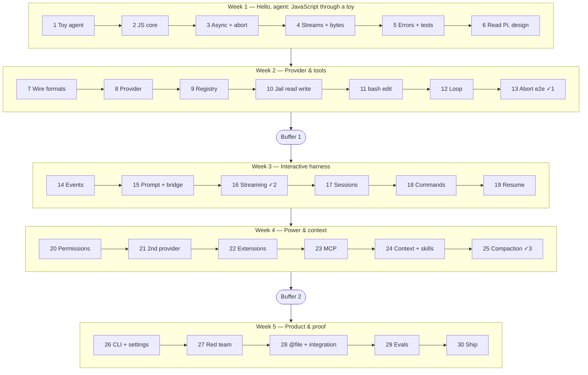

# Build an Agent Harness — 30 Days, JavaScript, From Scratch

By the end of **Day 1** you will have a working AI agent in about 70 lines of JavaScript. It reads your question, decides to run a shell command, asks your permission, runs it, and answers from the result.

Over the next 29 days you turn that toy into a real **terminal coding agent**, the same kind of program as Claude Code, Codex CLI or Pi, built by you with no agent framework:

```
> what does src/greet.js export? and add a farewell() next to it
  ⚙ read {"path":"src/greet.js"}
  · ✓ export function greet(name) {
  ⚙ edit {"path":"src/greet.js", …}
  allow edit {"path":"src/greet.js", …}? [y]es / [N]o / [a]lways this session y
  · ✓ Edited src/greet.js.
agent> greet.js exports greet(name). I added farewell(name) below it — it returns "Goodbye, <name>!".
> /resume                                       ← sessions survive restarts
> @notes.txt summarise this                     ← attach files
```

It streams tokens and the model's thinking, runs tools behind an approval gate with permission rules, saves sessions you can resume, compacts long conversations, loads extensions and **MCP servers**, follows project instructions in `AGENTS.md`, uses **Agent Skills**, and ships with an eval suite. Along the way you learn the JavaScript it is written in.

**Contents:** [Who this is for](#who-this-is-for) · [How the course works](#how-the-course-works) · [The 30-day plan](#the-30-day-plan) · [Environment & course model](#environment--course-model) · [Course tests & solutions](#course-tests--solutions) · [Reference](#reference) · [Checkpoints](#checkpoints) · [Reading list](#reading-list) · [After the course](#after-the-curriculum) · [Troubleshooting](reference.md#troubleshooting)

---

## Who this is for

- You can program in another language (the contrast notes assume some C, C++ or Python). You **don't need to know JavaScript**: Day 2 starts from `typeof`, and if you've dabbled, week 1 fills the gaps.
- Week 1 teaches the JavaScript the rest of the course leans on: values and their traps, closures, `this`, the event loop, `async`/`await`, generators, streams, and bytes versus strings. Each idea gets a small experiment in a scratch file first, then goes **straight into your toy agent**.
- Days vary in size. Each day's header says whether it takes **one sitting or two**, and two optional **buffer days** give you room to catch up.

You will finish at an intermediate level in JavaScript and harness engineering, and you will have touched the advanced topics: stream assembly, compaction invariants, plugin trust boundaries, prompt-injection defence, and eval design.

## How the course works

**Every day has the same shape:**

| Section | What it gives you |
|---|---|
| **By tonight** | What will work at the end of the day, usually with a short transcript |
| **Why it matters** | The real-world problem the day solves |
| **Concepts** | Plain-language explanations, a diagram, and the JavaScript you need |
| **Build** | Guided steps with starter code. Core steps first, then optional Stretch |
| **Check** | The day's **course tests** plus a live demo you run yourself |
| **Stuck?** | Collapsible hints, from a gentle nudge to the near-answer |
| **Common mistakes**, **Self-check**, **Further reading** | Catch silent misunderstandings; go deeper |

**Rules of thumb**
1. Read the whole day before you code.
2. Do **Core** first. **Stretch** never blocks a later day.
3. Make the day's course tests pass. They are the spec ([how](#course-tests--solutions)).
4. Run the day's live demo. Seeing your agent do something new is the point.
5. **Commit every day**: `git commit -m "day-07: wire captures + message schemas"`. Day 30 reviews this history.
6. Checkpoints (Days 13, 16, 25) gate the next phase. If one is red, use the next buffer day to fix it.

### Something works every few days

| Week | Days | What you can *see* working |
|---|---|---|
| 1 | 1–6 | **Day 1: a working toy agent.** Day 2: you delete one `await` and watch it run a command without asking, then fix it. Day 3: Ctrl+C aborts it. Day 4: it streams tokens and thinking live. Day 5: green tests. Day 6: your design becomes an executable check of the loop's events |
| 2 | 7–13 | Real wire captures, a provider with readable error messages, jailed file tools, `edit` changing real files. **Day 12: your real loop runs a tool you approved.** Day 13: abort kills a running `sleep 30` |
| 3 | 14–19 | **Day 15: you chat with your own harness.** Day 16: it streams. Day 18: slash commands. Day 19: it remembers you across restarts |
| 4 | 20–25 | Day 20: permission rules ("always allow `git status`"). Day 21: a second provider. Day 22: plugins. **Day 23: an MCP server's tools show up in your agent.** Day 24: skills and AGENTS.md. Day 25: long chats compact |
| 5 | 26–30 | Day 26: a real CLI (`agent-harness -p "…"`). **Day 27: you attack your own agent.** Day 28: `@file` attachments. Day 29: an eval table across models. Day 30: you ship it |

---

## The 30-day plan



| Day | File | You build | JavaScript focus | Demo tonight |
|----:|------|-----------|------------------|--------------|
| 1 | [day-01](day-01.md) | Setup + a 70-line toy agent | ESM, `fetch`, top-level `await` | The agent runs a command you approved |
| 2 ⚠ | [day-02](day-02.md) | Refactor the toy into modules | values, closures, `this`, classes vs factories, JSDoc | Same agent in four modules, and the missing `await` that skips your approval |
| 3 ⚠ | [day-03](day-03.md) | Ctrl+C aborts the toy; first course tests | event loop, promises, `AbortController` | Ctrl+C stops an answer, a command or a question |
| 4 ⚠ | [day-04](day-04.md) | Streaming toy + `src/shared/ndjson.js` + `src/tools/truncate.js` | generators, streams, `Buffer` vs strings | Tokens and thinking stream live |
| 5 ⚠ | [day-05](day-05.md) | Errors, `node:test`, `src/cli/args-parser.js` (the toy's first flags) | errors, validation, DI | All course tests green |
| 6 | [day-06](day-06.md) | Read Pi, design your harness, executable event protocol | reading TypeScript, state machines | Your protocol's tests pass |
| 7 | [day-07](day-07.md) | Wire captures + message schemas | JSDoc typedefs | Your own captures in `fixtures/` |
| 8 | [day-08](day-08.md) | `OllamaProvider.chat()` + error taxonomy + real context limit | classes, `fetch`, `cause` | `node scripts/smoke-provider.js` |
| 9 | [day-09](day-09.md) | Tool contracts + registry, a tool-description experiment | `Map`, validation | Your measured table: clear vs vague descriptions |
| 10 | [day-10](day-10.md) | Path jail (with symlinks, dangling ones too), `read`, `write` | `fs/promises`, `path` | `read` refuses `../etc/passwd` |
| 11 ⚠ | [day-11](day-11.md) | `bash` (nothing outlives a command), `edit`, threat model v1 | `child_process`, signals, process groups | The toy runs commands through the real `bash` tool |
| 12 ⚠ | [day-12](day-12.md) | `AgentLoop` + minimal approval | async control flow | **Your real loop runs a tool you approved** |
| 13 | [day-13](day-13.md) | Abort + `ScriptedProvider` + e2e — **Checkpoint 1** | AbortSignal patterns | Ctrl+C kills `sleep 30` mid-run |
| — | [buffer-1](buffer-1.md) | Catch up, repair, or challenge | — | — |
| 14 | [day-14](day-14.md) | Canonical events, `EventBus`, printer | listener registries | Coloured event trace |
| 15 ⚠ | [day-15](day-15.md) | `PromptUI` + `UIBridge` | `readline`, lifecycles | **You chat with your own harness** |
| 16 ⚠ | [day-16](day-16.md) | `chatStream` + parity — **Checkpoint 2** | async generators | Live streaming harness |
| 17 | [day-17](day-17.md) | JSONL sessions + `SessionManager` | `fs` appends, atomic writes | Session files on disk |
| 18 | [day-18](day-18.md) | Slash commands + `/model` | dispatch tables | `/help`, `/model` |
| 19 | [day-19](day-19.md) | Auto-save, `/resume`, continuity | state machines | It remembers "blue" after a restart |
| 20 ⚠ | [day-20](day-20.md) | Approval gate + permission rules & modes | promise-per-id | "Always allow `git status`" |
| 21 | [day-21](day-21.md) | OpenAI-compatible provider (SSE, fragmented args) | incremental parsing | Same harness, second provider |
| 22 | [day-22](day-22.md) | Extensions with a trust boundary | dynamic `import()` | A plugin tool appears |
| 23 ⚠ | [day-23](day-23.md) | MCP client (stdio, 2026-07-28 spec) | JSON-RPC, child processes | An MCP server's tools in your agent |
| 24 ⚠ | [day-24](day-24.md) | Token budget, system prompt, AGENTS.md, Skills, caching | estimation | A skill loads on demand |
| 25 ⚠ | [day-25](day-25.md) | Compaction with invariants — **Checkpoint 3** | invariants, trees | A long chat compacts and keeps going |
| — | [buffer-2](buffer-2.md) | Catch up, repair, or challenge | — | — |
| 26 ⚠ | [day-26](day-26.md) | CLI, secure settings layers, logging, packaging | process lifecycle | `agent-harness -p "…"` |
| 27 | [day-27](day-27.md) | **Red-team day**: attack your own agent | — | Your attack report |
| 28 | [day-28](day-28.md) | `@file` refs, Tab completion, multi-line, integration suite | parsing, fs walks | `@notes.txt summarise this` |
| 29 | [day-29](day-29.md) | Evals: trials, pass@k, model comparison | measurement | Your eval table |
| 30 | [day-30](day-30.md) | Demo, docs, capstone — **graduate** | shipping | Offline demo + a capstone feature |

**Heavier days** take two sittings and are marked ⚠, here and in their header: Days 2, 3, 4, 5, 11, 12, 15, 16, 20, 23, 24, 25 and 26. Each has more to read or more to build than a normal day, so plan a break in the middle. Every other day takes one sitting. Week 1 is the heaviest week, because it teaches the language as well as the agent, and Day 6 is deliberately light: it is week 1's catch-up room.

---

## Environment & course model

| Need | Version | Why |
|---|---|---|
| **Node.js** | **24 LTS** (22 is the minimum) | Node 20 reached end-of-life on 2026-04-30. Node 24 is Active LTS until April 2028. `node --test`, `AbortSignal.any`, `fetch` and `readline/promises` are all built in |
| **Ollama** | recent; verified on **0.32.0**, re-checked on 0.35.0 and 0.35.1 | Runs models locally. No API keys, no cost |
| **git** | any | One commit per day |
| Disk / RAM | about 4 GB disk, 8 GB+ RAM | For the course model |
| **Pi** (read-only) | **0.80.3**, cloned on Day 6 | The open-source harness you study on Days 6 and 30. Day 6 gives the one-line `git clone` ([also here](reference.md#pis-architecture)) |

### The course model

This is the one place the model is chosen. Code reads it from `src/shared/constants.js` (`DEFAULT_MODEL`), and later from your settings file.

| Your machine | Model | Pull |
|---|---|---|
| 8–16 GB RAM (**default**) | `qwen3.5:4b` | `ollama pull qwen3.5:4b` |
| 16 GB+ RAM | `qwen3.5:9b` | `ollama pull qwen3.5:9b` |
| Anything else | any model whose `/api/show` `capabilities` include `"tools"` (browse [ollama.com/search?c=tools](https://ollama.com/search?c=tools)) | — |

Models without the `thinking` capability work too: the provider stops sending `think` after Ollama refuses it once (Day 8). But **size matters more than the capability list**. We ran `llama3.2:1b` and `qwen2.5:0.5b` through the finished harness: they echoed tool definitions back as text, invented arguments and file contents, and looped until `maxTurns`. The harness handled every one of those correctly; the models just weren't usable agents. Use about 4B parameters or more.

`qwen3.5:4b` was verified on 2026-10-01 against Ollama 0.32.0. It handles tool calls, including parallel calls, plus thinking, streaming, and both the native and OpenAI-compatible APIs. The real responses are saved in [`course-assets/captures/ollama-0.32/`](course-assets/captures/ollama-0.32/). If you switch models, re-capture on Day 7: **your capture is the ground truth.**

> **The one Ollama fact that bites everyone:** Ollama runs models with a **4096-token** window by default on machines with less than 24 GiB of VRAM, whatever the model supports. Overflow is **silent**: no error, the start of the prompt (your system prompt and tool definitions) is simply dropped. We verified it. With an 11k-token prompt the server returned HTTP 200, processed only 2,050 tokens, and the model forgot its instructions. With `options.num_ctx: 16384` it read everything. **Your harness sends `num_ctx` on every request** (Day 1 onward), and budgets against `min(num_ctx, model maximum)` (Days 8, 24). From Day 8 it also sends `num_predict`, because Ollama's default output limit is *unlimited*: a runaway model never stops. Check what is actually running with `ollama ps`.

---

## Course tests & solutions

**Course tests** (`course-tests/day-NN/`) are acceptance tests for each day's modules: the toy in week 1, then `src/`. They are the precise spec, they need no network, and they turn green when you are done.

```bash
# inside your agent-harness project, from Day 3 on:
mkdir -p tests/course
cp ../agent-harness-curriculum/course-tests/day-03/*.test.js tests/course/
node --test                        # runs every *.test.js under the project, yours and the course's
node --test tests/course/day03-*   # just today's
```

`node --test` takes files or glob patterns, not directories: on Node 22+, `node --test tests/course/` fails with `Cannot find module`.

They import your code from `../../src/...`, so the [project structure](#project-structure-target) matters. Write **your own** tests too (each day asks for some). Course tests check the contract; yours check your understanding.

**Reference solutions** (`solutions/`) are snapshots of a complete, tested implementation:

| Folder | State | Use it when |
|---|---|---|
| `solutions/toy/` | The toy agent: Day 1 single file, plus the Days 2–5 modules | You are stuck in week 1 |
| `solutions/checkpoint-1/` | End of Day 13 | Checkpoint 1 is red and a buffer day didn't fix it |
| `solutions/checkpoint-2/` | End of Day 16 | Same, for Checkpoint 2 |
| `solutions/checkpoint-3/` | End of Day 25 | Same, for Checkpoint 3 |
| `solutions/final/` | End of Day 30 | After you finish, to compare designs |

> **Spoiler policy.** Try the day's **Stuck?** hints first, then read *one file* of the solution, then close it and write your own. Copying a checkpoint wholesale is allowed. It is better than quitting, but note it in your daily commit message.

## Dependency policy

**Build the agent core yourself.** No LangChain, no agent framework, no coding-agent SDK, no MCP SDK.

| When | Allowed | Why |
|---|---|---|
| Days 1–8 | Node built-ins only | Learn `fetch`, modules, tests, async |
| Day 9+ | Optional JSON Schema validator (e.g. Ajv) | Only after the hand-rolled checker works |
| Any day | `typescript` as a dev dependency for `tsc --checkJs` (Day 5 stretch) | Type-check your JSDoc |
| After Day 30 | A TUI library, an MCP SDK, anything | You will know what it does for you |

## Project structure (target)

```
agent-harness/
├── toy/                       # Days 1–4: the toy agent (kept as a museum piece)
├── src/
│   ├── agent/                 agent-loop.js · agent-schemas.js · approval-gate.js (20) · permissions.js (20)
│   ├── provider/              ollama.js (8) · scripted.js (13) · openai-compatible.js · index.js (21)
│   │                          parse-arguments.js (8) · tool-call-assembler.js (16)
│   ├── tools/                 tool-registry.js (9) · workspace-path.js (10) · truncate.js (4)
│   │   └── builtin/           index.js · read.js · write.js (10) · bash.js · edit.js (11)
│   ├── events/                event-bus.js (14)
│   ├── ui/                    printer.js (14; sanitizeForTerminal 27) · prompt-ui.js (15)
│   │                          file-refs.js · file-finder.js · completer.js (28)
│   ├── session/               jsonl-utils.js · session-manager.js (17)
│   ├── commands/              registry.js · builtin/index.js (18)
│   ├── extensions/            loader.js · trust.js (22)
│   ├── mcp/                   mcp-client.js · mcp-tools.js (23)
│   ├── context/               token-estimator.js · budget.js · project-instructions.js · skills.js
│   │                          system-prompt-builder.js (24) · compaction.js (25)
│   ├── config/                paths.js (17) · settings.js · logger.js · error-handler.js (26)
│   ├── cli/                   args-parser.js (5) · main.js (15 → 26)
│   ├── shared/                constants.js · errors.js (5) · ndjson.js (4) · message-schemas.js (7)
│   │                          tool-schemas.js (9) · events.js (14) · session.js (17) · commands.js (18)
│   │                          extension.js (22) · sse.js (21)
│   ├── bridge.js              UIBridge (15)
│   ├── app.js                 createApp(): wires everything (15, grows)
│   └── index.js               public API (26)
├── scripts/                   smoke-provider.js (8) · smoke-loop.js (12) · trace.js (14) — live checks, never shipped
├── tests/                     your tests;  tests/course/ = copied course tests (3+);  tests/helpers/event-protocol.js (6);  tests/integration/ (28)
├── fixtures/                  your Ollama captures (7), golden session (17), compaction entry (25)
├── examples/                  extensions/ (22, 30) · mcp/ (23) · redteam-repo/ (27) · evals/ (29) · demo.js (30)
├── notes/                     daily notes · tool-security.md (11 → 27) · redteam-report.md (27)
├── docs/                      architecture.md · extending.md · api.md (30)
└── package.json               "type": "module"
```

---

## Reference

The contracts every module shares (the event list, message and tool shapes, the truncation contract, approval and permissions, trust boundaries, settings and CLI flags), the glossary, the troubleshooting table and a map of Pi live on their own page: [Reference](reference.md). You don't need to read it before Day 1. Each day links to the part it uses, on the day it uses it.

## Checkpoints

| Gate | After | You must have |
|---|---|---|
| 1 | Day 13 | Headless engine: tool loop, maxTurns, fail-closed approval, abort kills tools, course tests green with Ollama **stopped**, one live approved tool turn |
| 2 | Day 16 | Interactive streaming harness: live text and thinking, tool calls, Ctrl+C abort, prompt always comes back |
| 3 | Day 25 | Protocol stays valid: compaction keeps tool pairs whole and the latest user message; budget uses the *real* window |
| Graduation | Day 30 | All course tests green, eval table from real runs, red-team report, docs + offline demo shipped |

## Reading list

Read these as the days ask for them; they are also good on their own.

- Thorsten Ball, [How to Build an Agent](https://ampcode.com/how-to-build-an-agent) (2025): the "LLM, a loop, and enough tokens" essay behind Day 1.
- Mario Zechner, [What I learned building an opinionated and minimal coding agent](https://mariozechner.at/posts/2025-11-30-pi-coding-agent): the design rationale for Pi (Days 6, 30).
- Anthropic, [Building effective agents](https://www.anthropic.com/engineering/building-effective-agents), [Writing effective tools for agents](https://www.anthropic.com/engineering/writing-tools-for-agents) and [Effective context engineering for AI agents](https://www.anthropic.com/engineering/effective-context-engineering-for-ai-agents) (Days 9, 24, 25).
- Simon Willison, [The lethal trifecta](https://simonwillison.net/2025/Jun/16/the-lethal-trifecta/) (Days 11, 24, 27).
- Ollama docs: [chat API](https://docs.ollama.com/api/chat), [tool calling](https://docs.ollama.com/capabilities/tool-calling), [context length](https://docs.ollama.com/context-length) (Days 7, 8, 16).
- [Model Context Protocol specification (2026-07-28)](https://modelcontextprotocol.io/specification/2026-07-28) (Day 23).
- [Agent Skills](https://agentskills.io/) and [AGENTS.md](https://agents.md/) (Day 24).
- MDN [JavaScript Guide](https://developer.mozilla.org/en-US/docs/Web/JavaScript/Guide) and the [Node.js API docs](https://nodejs.org/api/) (week 1, and always).

## After the Curriculum

Day 30 asks you to pick one capstone. The rest make good next projects:

- **A full TUI**: raw mode, differential rendering, a multi-line editor (study `@earendil-works/pi-tui`).
- **Hosted providers**: Anthropic Messages and OpenAI Responses. Your `ScriptedProvider` seam already proves the interface.
- **OS-level sandboxing** for `bash`: macOS `sandbox-exec`, Linux bubblewrap or Landlock, or a container. This is what moves "approval" towards "containment".
- **Sub-agents**: a `task` tool that runs a fresh `AgentLoop` with its own context and returns a summary.
- **LLM-written compaction summaries** with re-entrancy guards (the Day 25 stretch, done properly).
- **An MCP server of your own**, so other harnesses can use your tools.
- **Evals that matter**: grow `examples/evals/` into a regression suite and track pass^k across models and releases.

See [CHANGELOG.md](CHANGELOG.md) for what changed in this edition and why.

## License

- **The written course** (`README.md`, `reference.md`, the `day-*.md` and `buffer-*.md` pages, `self-check-answers.md` and `CHANGELOG.md`) is licensed under [CC BY 4.0](LICENSE-CONTENT). You may share and adapt it, with attribution.
- **The code** (`solutions/`, `course-tests/` and `course-assets/`) is licensed under the [MIT License](LICENSE).
